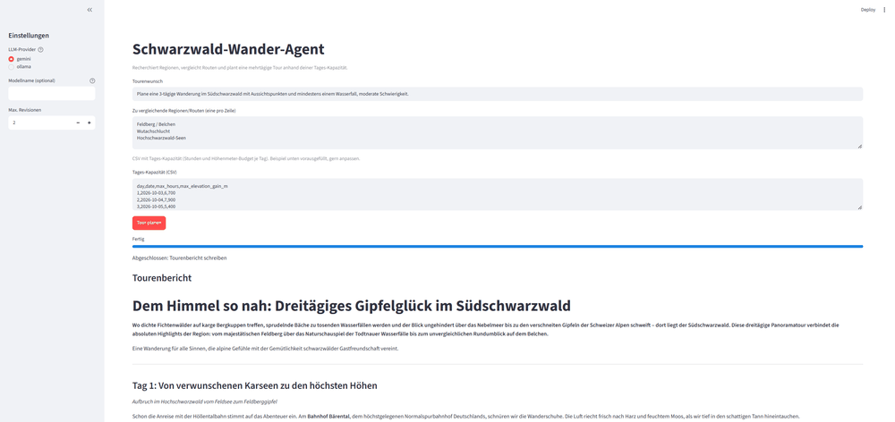
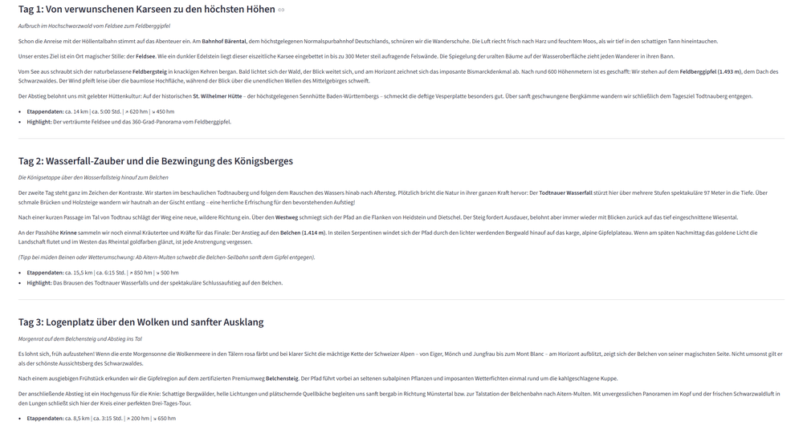
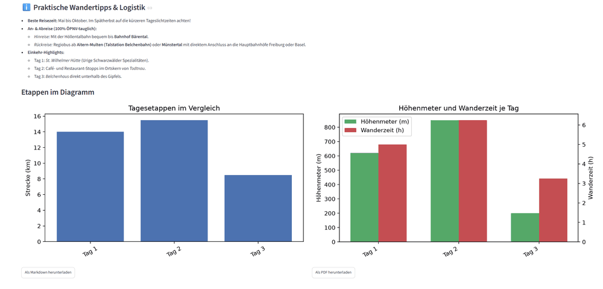

# Schwarzwald-Wander-Agent

Ein LangGraph-Agent, der aus einem Tourenwunsch, mehreren zu vergleichenden Schwarzwald-Regionen und einer Tages-Kapazität (verfügbare Stunden, Höhenmeter-Budget pro Tag) automatisiert eine recherchierte, mehrtägige Wanderroute plant: Rahmenbedingungen erfassen, analysieren, Regionen recherchieren (Tavily-Websuche), Routen vergleichen, über eine Feedback-Revisionsschleife verbessern und als Tourenbericht mit Etappen-Diagrammen ausgeben.

## Screenshots

**Formular und generierter Tourenbericht**



**Tag-für-Tag-Gliederung mit Etappendaten**



**Diagramme und Export**



## Architektur

Der Agent ist als LangGraph-Graph mit Reflection-Schleife aufgebaut: erzeugen → recherchieren → vergleichen → Feedback-Revisionsschleife → strukturierte Etappen-Extraktion → finaler Output. Domäne, State-Modell, alle Prompts und die strukturierte Extraktion sind speziell für die Tourenplanung geschrieben.

## Funktionen

- Wahl zwischen Gemini API und lokalem Ollama-Modell zur Laufzeit
- Parallele Regionen-Recherche per `ThreadPoolExecutor`
- Strukturierte Etappen-Daten (Strecke, Höhenmeter, Zeit) über den Node `extract_itinerary`
- Diagramme sowie Markdown- und PDF-Export
- Retry-Logik für LLM- und Tavily-Aufrufe
- Modularer Aufbau in einzelnen Dateien

## Setup

```bash
git clone <repo-url>
cd schwarzwald-wander-agent
python -m venv .venv
source .venv/bin/activate
pip install -r requirements.txt
cp .env.example .env
# GEMINI_API_KEY und TAVILY_API_KEY in .env eintragen
```

Gemini-Key: kostenlos über [Google AI Studio](https://aistudio.google.com/). Tavily-Key: kostenlos über [tavily.com](https://tavily.com/) (begrenztes Freikontingent). Für `provider=ollama` wird zusätzlich ein lokal laufendes [Ollama](https://ollama.com/) mit heruntergeladenem Modell benötigt (z. B. `ollama pull llama3.2`) - ein Tavily-Key bleibt trotzdem nötig, da die Websuche unabhängig vom LLM-Provider läuft.

### Streamlit-Oberfläche

```bash
streamlit run app.py
```

Tourenwunsch, Regionen und Tages-Kapazität sind mit einem Beispiel vorausgefüllt und direkt im Formular editierbar.

### Tests

```bash
pytest
```
